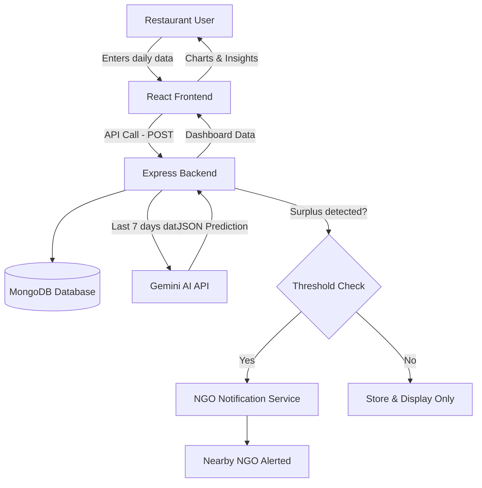

# 🍽️ Food Surplus Prediction & NGO Notification System

An AI-powered MERN stack application that predicts restaurant food demand, detects surplus, and automatically notifies nearby NGOs for pickup — reducing food waste and helping it reach people in need.

> Inspired by real-world volunteering experience with **Robin Hood Army**, where restaurant food surplus is collected manually and distributed to the underprivileged. This project aims to make that process **proactive instead of reactive**.

---

## 📖 Table of Contents

- [Problem Statement](#-problem-statement)
- [Solution Overview](#-solution-overview)
- [Features](#-features)
- [Tech Stack](#-tech-stack)
- [System Architecture](#-system-architecture)
- [Workflow](#-workflow)
- [Database Schema](#-database-schema)
- [API Endpoints](#-api-endpoints)
- [AI / Prompt Engineering](#-ai--prompt-engineering)
- [Installation & Setup](#-installation--setup)
- [Environment Variables](#-environment-variables)
- [Project Structure](#-project-structure)
- [Future Scope](#-future-scope)
- [Author](#-author)

---

## 🎯 Problem Statement

Restaurants often **overcook or undercook** food because they have no data-driven way to estimate next day's demand. This leads to:
- Excess food waste when surplus isn't utilized in time
- Missed opportunities for NGOs to collect and redistribute food to those in need
- No early warning system — surplus is only discovered *after* the food is already wasted

## 💡 Solution Overview

This system collects a restaurant's historical cooking/consumption data, uses the **Gemini AI API** to forecast the next day's demand, flags expected surplus, and **automatically alerts nearby NGOs** so pickups can be planned in advance instead of last-minute.

---

## ✨ Features

| Feature | Description |
|---|---|
| 📊 Daily Data Logging | Restaurants log how much food was cooked vs. consumed each day |
| 🤖 AI Demand Prediction | Gemini API analyzes the last 7 days of data to forecast tomorrow's demand |
| ⚠️ Surplus Detection | System flags expected surplus based on a configurable threshold |
| 🔔 NGO Notification | Nearby NGOs are alerted automatically when surplus is predicted |
| 📈 Analytics Dashboard | Visual charts (Chart.js) comparing predicted vs. actual demand over time |
| 🔐 Restaurant Authentication | Secure signup/login with hashed passwords |

---

## 🛠️ Tech Stack

| Layer | Technology |
|---|---|
| Frontend | React.js |
| Backend | Node.js, Express.js |
| Database | MongoDB (Mongoose ODM) |
| AI / Forecasting | Gemini API (LLM-based prediction) |
| Visualization | Chart.js |
| Authentication | bcrypt (password hashing) |
| API Testing | Postman |
| Version Control | Git & GitHub |

---

## 🏗️ System Architecture



---

## 🔄 Workflow

| Step | Action |
|---|---|
| 1 | Restaurant logs in and submits daily cooked/consumed data via React form |
| 2 | Express backend validates and stores the data in MongoDB |
| 3 | Backend fetches the last 7 days of records using a MongoDB aggregation query |
| 4 | This data is sent to the Gemini API with a structured prompt |
| 5 | Gemini returns a JSON prediction: `predictedDemand`, `recommendedCooking`, `expectedWaste` |
| 6 | Backend validates the AI response (format + logical sanity checks) |
| 7 | If expected surplus crosses the threshold, the NGO notification is triggered |
| 8 | Dashboard updates with prediction charts and historical trends |

---

## 🗄️ Database Schema

### `restaurants`

| Field | Type | Description |
|---|---|---|
| `_id` | ObjectId | Unique identifier |
| `name` | String | Restaurant name |
| `email` | String | Login email |
| `password` | String | Hashed password (bcrypt) |
| `location` | String | Address / area |

### `dailyData`

| Field | Type | Description |
|---|---|---|
| `_id` | ObjectId | Unique identifier |
| `restaurantId` | ObjectId (ref) | Links to `restaurants` |
| `date` | Date | Date of the record |
| `cookedQty` | Number | Quantity cooked |
| `consumedQty` | Number | Quantity actually consumed |
| `wasteQty` | Number | Calculated leftover |

### `predictions`

| Field | Type | Description |
|---|---|---|
| `_id` | ObjectId | Unique identifier |
| `restaurantId` | ObjectId (ref) | Links to `restaurants` |
| `date` | Date | Date prediction is for |
| `predictedDemand` | Number | AI-forecasted demand |
| `recommendedCooking` | Number | Suggested quantity to cook |
| `expectedWaste` | Number | Predicted surplus |

### `ngos`

| Field | Type | Description |
|---|---|---|
| `_id` | ObjectId | Unique identifier |
| `name` | String | NGO name |
| `location` | String | Operating area |
| `contactInfo` | String | Email / phone for alerts |

**Relationships:** MongoDB has no foreign keys like SQL — relations are maintained using `ObjectId` references (e.g., `dailyData.restaurantId` → `restaurants._id`), and an index on `{ restaurantId, date }` keeps the frequent "last 7 days" queries fast.

---

## 🔌 API Endpoints

| Method | Endpoint | Description |
|---|---|---|
| `POST` | `/api/auth/signup` | Register a new restaurant |
| `POST` | `/api/auth/login` | Restaurant login |
| `POST` | `/api/data` | Submit daily cooked/consumed data |
| `GET` | `/api/data/:restaurantId` | Fetch historical data for a restaurant |
| `GET` | `/api/predict/:restaurantId` | Get AI-generated demand prediction |
| `GET` | `/api/predictions/:restaurantId` | Fetch past predictions for dashboard charts |
| `POST` | `/api/notify` | Trigger NGO notification (internal, called when surplus detected) |

---

## 🤖 AI / Prompt Engineering

The system sends the last 7 days of restaurant data to Gemini with a tightly structured prompt that:
1. Provides clear context (historical cooked vs. consumed data)
2. Defines the exact task (predict tomorrow's demand)
3. Locks the output format to JSON only — no free text

**Example prompt:**
```
You are a food demand forecasting assistant.
Here is the last 7 days of data for a restaurant:
Mon: Cooked 100, Consumed 90
Tue: Cooked 120, Consumed 115
...

Predict tomorrow's demand, recommended cooking quantity, and expected surplus.
Respond ONLY in this JSON format:
{"predictedDemand": number, "recommendedCooking": number, "expectedWaste": number}
```

**Safeguards added:**
- Response is validated for correct JSON structure before use
- Illogical values (e.g., negative demand) trigger a fallback (last 3-day average)
- Retry logic handles transient API failures gracefully

---

## ⚙️ Installation & Setup

```bash
# Clone the repository
git clone https://github.com/Adarshgupta1807/<repo-name>.git
cd <repo-name>

# Install backend dependencies
cd backend
npm install

# Install frontend dependencies
cd ../frontend
npm install

# Start backend server
cd ../backend
npm run dev

# Start frontend
cd ../frontend
npm start
```

---

## 🔐 Environment Variables

Create a `.env` file inside the `backend` folder:

| Variable | Description |
|---|---|
| `MONGO_URI` | MongoDB connection string |
| `GEMINI_API_KEY` | API key for Gemini |
| `PORT` | Backend server port |

---

## 📁 Project Structure

```
project-root/
├── backend/
│   ├── models/          # Mongoose schemas (Restaurant, DailyData, Prediction, NGO)
│   ├── routes/          # Express route handlers
│   ├── controllers/     # Business logic
│   ├── utils/           # Gemini API helper, validation functions
│   ├── .env
│   └── server.js
├── frontend/
│   ├── src/
│   │   ├── components/  # Reusable UI components
│   │   ├── pages/       # Dashboard, Login, Signup
│   │   └── App.js
│   └── package.json
└── README.md
```

---

## 🚀 Future Scope

- JWT-based authentication for more scalable session management
- Real-time NGO notifications via Email/SMS (Nodemailer/Twilio)
- Admin approval flow to verify new restaurant signups
- Multi-city scalability for broader NGO coverage

---

## 👤 Author

**Adarsh Gupta**
B.Tech CSE, Maharana Institute of Professional Studies

> Built out of real volunteering experience with **Robin Hood Army** — turning a manual, reactive food-rescue process into a proactive, data-driven one.
