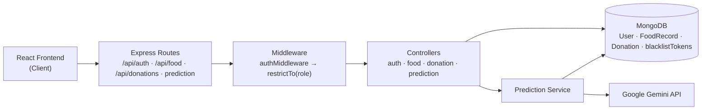
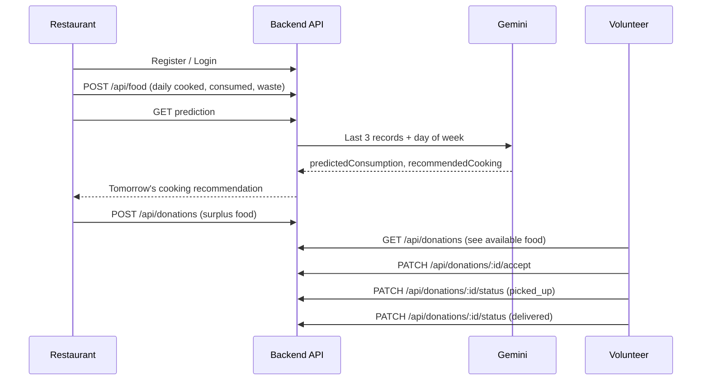

# 🍛 Food Prediction & Distribution System

> Cook the right amount. Donate the rest. Waste nothing.

A full-stack **MERN** application (React frontend + Node/Express backend) that helps restaurants **predict tomorrow's food demand using AI** and **donate surplus food to volunteers** through a simple, trackable donation workflow.

---

## 📌 Table of Contents

- [Problem Statement](#-problem-statement)
- [Features](#-features)
- [Tech Stack](#-tech-stack)
- [System Architecture](#-system-architecture)
- [Workflow](#-workflow)
- [Project Structure](#-project-structure)
- [Getting Started](#-getting-started)
- [Authentication](#-authentication)
- [API Reference](#-api-reference)
- [Database Schema](#-database-schema)
- [How the Prediction Works](#-how-the-prediction-works)
- [Future Improvements](#-future-improvements)
- [Author](#-author)

---

## 🎯 Problem Statement

Restaurants often cook more food than they can sell, and the extra food goes to waste while many people go hungry. Two problems exist here:

1. **Over-cooking**: there is no data-driven way to decide how much to cook.
2. **No easy donation channel**: surplus food has no quick path to people who need it.

This project solves both. It predicts next-day consumption from past records, and it connects restaurants with volunteers who can pick up and deliver the leftover food.

---

## ✨ Features

- 🖥️ **React frontend** for restaurants and volunteers to log food, view predictions and manage donations
- 🔐 **Role-based authentication** for two roles: `restaurant` and `volunteer`
- 🍽️ **Food record management**: log cooked, consumed and wasted quantities (CRUD + stats)
- 🤖 **AI-powered prediction**: Google Gemini predicts tomorrow's consumption and recommended cooking quantity using recent records and the day of the week
- 🤝 **Donation workflow**: restaurants post surplus food, volunteers accept it and update status (`accepted` → `picked_up` → `delivered`)
- 🛡️ **Protected routes** with auth middleware and role restrictions
- 🚪 **Token blacklist** to invalidate tokens

---

## 🧰 Tech Stack

| Layer | Technology |
|-------|-----------|
| Frontend | React |
| Runtime | Node.js |
| Framework | Express.js |
| Database | MongoDB + Mongoose |
| AI | Google Gemini (`@google/genai`) |
| Auth | JWT-based auth, middleware + role restriction |

---

## 🏗️ System Architecture



**Request lifecycle**

1. The React app calls the API and sends the token in the `Authorization` header.
2. `authMiddleware` verifies the token, and `restrictTo(...)` checks the user's role.
3. The controller runs the business logic and talks to MongoDB.
4. For predictions, the service fetches recent food records and asks Gemini for a structured JSON answer.

---

## 🔄 Workflow

### End-to-end flow



---

## 📁 Project Structure

```
├── Frontend/                        # React app (feature-based structure)
│   └── src/
│       ├── features/
│       │   ├── auth/                # login, register
│       │   ├── donation/            # create, list, track donations
│       │   ├── ngo/                 # volunteer / NGO side screens
│       │   └── restaurant/          # food records, prediction, stats
│       │       ├── api/             # API calls for this feature
│       │       ├── hooks/           # custom hooks
│       │       ├── pages/           # route-level pages
│       │       ├── state/           # feature state
│       │       └── ui/              # reusable UI components
│       ├── routes/
│       │   └── AppRoutes.jsx
│       ├── shared/                  # common components and utilities
│       ├── App.jsx
│       ├── App.css
│       ├── index.css
│       └── main.jsx
│
└── Backend/                         # Node + Express API
    ├── controllers/
    │   ├── authController.js
    │   ├── donationController.js
    │   ├── foodController.js
    │   └── predictionController.js
    ├── middlewares/
    │   └── authMiddleware.js
    ├── models/
    │   ├── User.js
    │   ├── FoodRecord.js
    │   ├── Donation.js
    │   └── BlacklistToken.js
    ├── routes/
    │   ├── authRoutes.js
    │   ├── donationRoutes.js
    │   ├── foodRoutes.js
    │   └── predictionRoutes.js
    ├── services/
    │   └── predictionService.js
    └── server.js
```

Each frontend feature (`auth`, `donation`, `ngo`, `restaurant`) is self-contained with its own `api`, `hooks`, `pages`, `state` and `ui` folders, so features can grow independently without touching each other.

---

## ⚙️ Getting Started

### Prerequisites

- Node.js v18+
- MongoDB (local or Atlas)
- Google Gemini API key

### Installation

```bash
git clone https://github.com/Adarshgupta1807/Food-Prediction-and-Distribution-.git
cd Food-Prediction-and-Distribution-
```

**Backend**

```bash
cd Backend
npm run dev
```

**Frontend**

```bash
cd Frontend
npm run dev
```

### Environment variables

**`Backend/.env`**

```env
PORT=5000
MONGO_URI=your_mongodb_connection_string
JWT_SECRET=your_secret_key
GOOGLE_GENAI_API_KEY=your_gemini_api_key
```

**`Frontend/.env`**

```env
VITE_API_URL=http://localhost:5000/api
```

### Run

Start the backend and frontend in two separate terminals:

```bash
# Terminal 1: backend
cd Backend
npm start

# Terminal 2: frontend
cd Frontend
npm run dev
```

The frontend runs on `http://localhost:5173` and talks to the backend on `http://localhost:5000`.

> If your frontend uses Create React App instead of Vite, use `npm start` and the `REACT_APP_API_URL` variable. Also make sure CORS is enabled on the backend for the frontend's URL.

---

## 🔑 Authentication

Protected routes need a token in the request header:

```
Authorization: Bearer <token>
```

Get the token from the login API. Invalidated tokens are stored in the `blacklistTokens` collection and rejected by the auth middleware.

| Role | Can do |
|------|--------|
| `restaurant` | Manage food records, get predictions, create donations, view donations |
| `volunteer` | View donations, accept donations, update donation status |

---

## 📡 API Reference

### Auth: `/api/auth`

| Method | Endpoint | Description | Access |
|--------|----------|-------------|--------|
| POST | `/register` | Register a new user | Public |
| POST | `/login` | Login based on role | Public |

### Food records: `/api/food`

| Method | Endpoint | Description | Access |
|--------|----------|-------------|--------|
| POST | `/` | Add a food record | Restaurant |
| GET | `/` | Get my food records | Restaurant |
| GET | `/stats` | Get food statistics | Restaurant |
| PUT | `/:id` | Update a food record | Restaurant |
| DELETE | `/:id` | Delete a food record | Restaurant |

### Donations: `/api/donations`

| Method | Endpoint | Description | Access |
|--------|----------|-------------|--------|
| POST | `/` | Create a donation | Restaurant |
| GET | `/` | List donations | Restaurant, Volunteer |
| PATCH | `/:id/accept` | Accept a donation | Volunteer |
| PATCH | `/:id/status` | Update donation status | Volunteer |

### Prediction: `/api/predict`

| Method | Endpoint | Description | Access |
|--------|----------|-------------|--------|
| GET | `/` | Predict tomorrow's consumption and cooking quantity | Restaurant |

> Replace `/api/predict` with the path where you mounted `predictionRouter`.

---

## 🗄️ Database Schema

All schemas use `timestamps: true`, so `createdAt` and `updatedAt` are added automatically.

### User

| Field | Type | Notes |
|-------|------|-------|
| `username` | String | Required |
| `email` | String | Required, unique |
| `password` | String | Required (stored hashed) |
| `role` | String | `volunteer` or `restaurant`, default `volunteer` |

### FoodRecord

| Field | Type | Notes |
|-------|------|-------|
| `restaurantId` | ObjectId → User | Required |
| `foodName` | String | Required |
| `cookedQty` | Number | Required |
| `consumedQty` | Number | Required |
| `wasteQty` | Number | Required |

### Donation

| Field | Type | Notes |
|-------|------|-------|
| `restaurantId` | ObjectId → User | Required, the donor restaurant |
| `ngoId` | ObjectId → User | Default `null`, set when a volunteer accepts |
| `foodName` | String | Required |
| `quantity` | Number | Required |
| `status` | String | `available`, `accepted`, `picked_up`, `delivered` (default `available`) |
| `pickupTime` | Date | Optional |

### BlacklistToken (`blacklistTokens`)

| Field | Type | Notes |
|-------|------|-------|
| `token` | String | Required, invalidated tokens that must no longer be accepted |

---

## 🧠 How the Prediction Works

1. Fetch the restaurant's **last 7 food records** from MongoDB.
2. Send this history to **Gemini** with a strict JSON response schema.
3. Gemini returns `predictedConsumption`, `recommendedCooking` and `reasoning`.
4. The server calculates `expectedWaste = recommendedCooking - predictedConsumption` itself, so the AI's math is never trusted.

If a restaurant has no records yet, the API returns zeros without calling Gemini.

---

## 🚀 Future Improvements

- Live location tracking for volunteers
- Notifications when a new donation is posted
- Charts on the dashboard for waste and consumption trends

---

## 👤 Author

**Adarsh Gupta**
